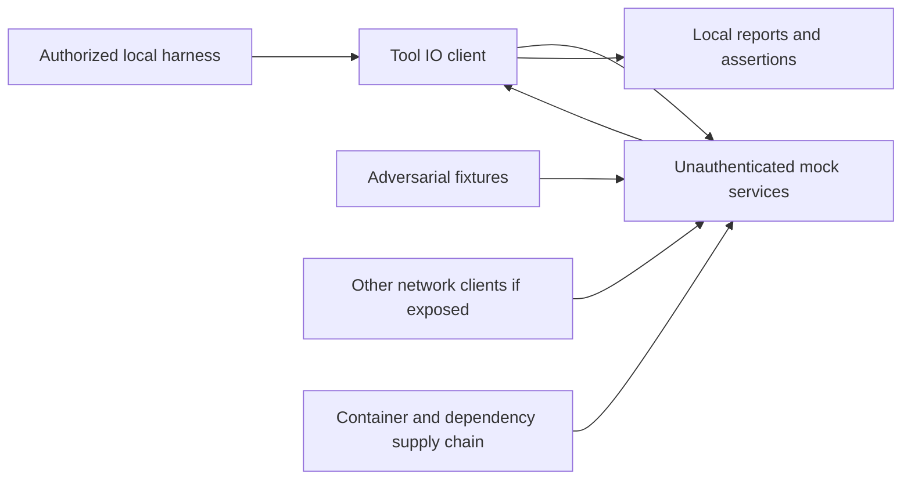

# adversarial_testing_toolio_examples detailed threat-model baseline

## Status and scope

Source baseline: `5fa2f772e9409831298524ab50a30f9595fe9bad`. Adoption: 2026-10-08.
Status: source-based initial model; independent human security review pending.
This model contains attack hypotheses, not validated vulnerability findings.
Existing canonical security documentation and stricter acceptance gates remain
applicable. Future changes must update this baseline rather than treating its
source revision as evidence for newer behavior.

Synthetic adversarial tool-I/O test laboratory, mock MCP/LLM services, fixtures, adapters and report tooling. Deliberately vulnerable and defended mock responses are demonstrations, not security boundaries. External harness/provider use may cause outbound disclosure and cost; authorized synthetic targets are the baseline.

## Assets, actors and assumptions

Assets: Harness/provider credentials; synthetic prompts and reports; operator host; test verdict integrity; build images and dependency provenance; report consumer/browser context.

Actors: Lab operator; malicious fixture or report author; user on reachable lab network; hostile model output; compromised harness/dependency; external provider retaining submitted prompts.

Assume an authorized operator, a trusted host and reviewed checkout. Treat input,
remote responses and imported content as untrusted. Repository access or a local
host administrator can bypass controls inside that same authority domain. Live
IAM, network controls, secret backend behavior and release protection require
operating evidence; they are not inferred from configuration files. Credentials,
private payloads and real identifiers must never be copied into this document.

## Components, data flows and trust boundaries

| Flow | Boundary and effective authority |
| --- | --- |
| Harness → mock MCP / LLM over Docker network | Published service ports can expose unauthenticated lab capabilities beyond the host. |
| Fixture / model / tool response → harness → report parser | Adversarial text must remain data; it may attempt prompt injection or falsify outcomes. |
| Parser → report artifact → browser/CI consumer | JSON, XML, archive, database and HTML consumers have independent resource and rendering boundaries. |
| Optional harness → external provider | Configured credentials and prompts leave the local lab; authorization and synthetic-data restrictions matter. |

The flow table defines the project-specific boundaries behind this overview.
Authentication of an upstream service does not make its content trusted. Review
the effective filesystem path, subprocess arguments, network recipient, cloud
account and credential recipient rather than only their user-supplied labels.

## Implementation evidence inventory

- `docker/docker-compose.yml`: inspect at the baseline revision; evidence scope is limited to this component.
- `docker/mock-mcp-server/server.py`: inspect at the baseline revision; evidence scope is limited to this component.
- `sdk/adversarial_toolio/parsers.py`: inspect at the baseline revision; evidence scope is limited to this component.
- `sdk/tests/test_sdk.py`: inspect at the baseline revision; evidence scope is limited to this component.
- `scripts/validate_fixtures.py`: inspect at the baseline revision; evidence scope is limited to this component.
- `docs/HARNESS_ARCHITECTURE.md`: inspect at the baseline revision; evidence scope is limited to this component.

## Threat register and prioritization

Impact High means private-data/credential exposure, authority escalation, material
integrity loss or substantial operational harm. Medium means bounded disclosure,
misleading results or recoverable disruption. Likelihood Medium means an exposed
or routinely supplied input could reach the boundary; Low needs stronger local
access or multiple prerequisites. P1 requires review/remediation or explicit human
risk acceptance before the affected capability is released; P2 requires scheduled
hardening and validation before expanding exposure. These are qualitative planning
priorities, not CVSS scores or proof of exploitability.

For every entry below, the human accountable owner is **maintainer/security
reviewer, assignment pending**. Triage within 30 days of adoption; complete P1
validation before the affected release/capability expansion and schedule P2 within
90 days. Existing controls do not close the hypothesis without validation.

### T01: Exposed unauthenticated lab

- Attack path / prerequisite: Another network user reaches mock service ports and abuses lab resources.
- Inherent impact: High; likelihood: Medium; priority: P1.
- Existing evidence / limitation: Compose publishes 8000:8000 and 8001:8001; mock MCP binds 0.0.0.0. These are not loopback-only defaults.
- Proposed mitigation and validation: Use isolated disposable environment or explicit loopback publishing; verify effective network exposure before starting services.
- Residual risk / status: unverified; human review and evidence pending. Retain
  this entry until a reviewer records outcome, exact revision and remaining risk.

### T02: Prompt/tool injection

- Attack path / prerequisite: Adversarial tool text causes an operator agent to execute commands or disclose real secrets.
- Inherent impact: High; likelihood: Medium; priority: P1.
- Existing evidence / limitation: Fixtures demonstrate attacks; defended mock regex behavior is not a general defense.
- Proposed mitigation and validation: Keep real credentials/data out of fixtures and tool context; require explicit capability authorization; test separation with synthetic sentinels.
- Residual risk / status: unverified; human review and evidence pending. Retain
  this entry until a reviewer records outcome, exact revision and remaining risk.

### T03: Verdict poisoning

- Attack path / prerequisite: Forged or ambiguous raw reports produce false pass/fail claims.
- Inherent impact: Medium; likelihood: Medium; priority: P2.
- Existing evidence / limitation: parsers.py has per-harness parsers; heterogeneous inputs retain interpretation risk.
- Proposed mitigation and validation: Test absent, duplicate, malformed and conflicting results; preserve provenance and raw-evidence digest; human inspect representative failures.
- Residual risk / status: unverified; human review and evidence pending. Retain
  this entry until a reviewer records outcome, exact revision and remaining risk.

### T04: Report consumer compromise

- Attack path / prerequisite: A crafted HTML/XML/archive/database report abuses a downstream renderer or importer.
- Inherent impact: High; likelihood: Medium; priority: P1.
- Existing evidence / limitation: Multiple report formats are supported; support is not proof of safe rendering or extraction.
- Proposed mitigation and validation: Inventory actual consumers; test escaping, safe XML settings, path confinement and archive/resource bounds where those operations occur.
- Residual risk / status: unverified; human review and evidence pending. Retain
  this entry until a reviewer records outcome, exact revision and remaining risk.

### T05: Provider data/cost escape

- Attack path / prerequisite: A harness sends private prompts or loops requests to a paid external model.
- Inherent impact: High; likelihood: Medium; priority: P1.
- Existing evidence / limitation: Harness selection/configuration can change execution recipients.
- Proposed mitigation and validation: Document opt-in external destination, synthetic-only data and request/cost limits; validate configuration before running.
- Residual risk / status: unverified; human review and evidence pending. Retain
  this entry until a reviewer records outcome, exact revision and remaining risk.

### T06: Laboratory overclaim

- Attack path / prerequisite: Mock attack coverage is represented as protection of a real deployed agent.
- Inherent impact: High; likelihood: Medium; priority: P1.
- Existing evidence / limitation: Mock and harness architecture separates demonstration surfaces.
- Proposed mitigation and validation: Label outcomes by harness/version/fixture/target and exact revision; require real authorized target evidence for effectiveness claims.
- Residual risk / status: unverified; human review and evidence pending. Retain
  this entry until a reviewer records outcome, exact revision and remaining risk.

### T07: Build or dependency compromise

- Attack path / prerequisite: A compromised dependency, image or workflow obtains developer or release authority.
- Inherent impact: High; likelihood: Medium; priority: P1.
- Existing evidence / limitation: Repository validation is evidence of local checks, not proof of dependency provenance or hosted policy.
- Proposed mitigation and validation: Inventory and pin applicable dependencies/actions/images; review changes, scan known issues and verify exact release artifact provenance.
- Residual risk / status: unverified; human review and evidence pending. Retain
  this entry until a reviewer records outcome, exact revision and remaining risk.

### T08: Incident recovery failure

- Attack path / prerequisite: Credentials, data or service availability cannot be recovered after compromise or accidental change.
- Inherent impact: High; likelihood: Low; priority: P2.
- Existing evidence / limitation: Operational checkpoints preserve code history; data and credential recovery require separate procedures.
- Proposed mitigation and validation: Human owner must document detection signals, restricted incident evidence, credential revocation, backups and a disposable restore exercise.
- Residual risk / status: unverified; human review and evidence pending. Retain
  this entry until a reviewer records outcome, exact revision and remaining risk.

## STRIDE and privacy coverage

| Category | Review obligation |
| --- | --- |
| Spoofing | Verify user/service/endpoint identity and binding to effective resource; reject stale/replayed authorization. |
| Tampering | Protect source, state, imported records and generated artifacts; test races and malformed input. |
| Repudiation | Record bounded, redacted action and review evidence with revision and actor; protect audit access. |
| Information disclosure | Trace secrets/private data through storage, logs, exports, backups and external recipients. |
| Denial of service | Bound input size, concurrency, retries and time; test dependency failure and recovery. |
| Elevation of privilege | Inventory tool/subprocess, filesystem, cloud and release privileges; deny unauthorized capability expansion. |
| Privacy | Confirm purpose, consent, minimization, retention/deletion and provider handling before real private data use. |

These obligations apply to each flow above. A component without a given surface
must record why the control is inapplicable; absence of evidence is not a pass.

## Security operations and open questions

Before real deployment or expanded capability, assign named human owners and
confirm effective identity/IAM, endpoint and network exposure, secret storage and
rotation, private-data lifecycle, dependency provenance, release authority and
resource limits. Record deployment/version-specific evidence and unresolved gaps.
Define redacted detection signals for rejected authorization, unexpected endpoint
changes, repeated parse failures and resource exhaustion where applicable. Keep
incident evidence access restricted. Document credential revocation, containment,
recovery owner, backups and restore validation; do not execute live destructive
or paid operations without their existing authorization.

Validate threats with synthetic negative tests and bounded local fixtures first;
use authorized integration/live checks only where needed and identify their
actual operating scope. A passing static/local test does not establish hosted,
packaged, cloud or physical-device assurance. Security findings discovered during
validation need reproducible evidence and separate tracked remediation.

## Maintenance and human acceptance

Update this model alongside changes to any listed asset, flow, recipient,
permission, parser, dependency, build or deployment assumption. Review at each
release and quarterly; record next review date when a human accepts the baseline.
Use [Engineering review policy](ENGINEERING_REVIEW.md) for reference frameworks,
checkpoint commits and exact-revision approval, and
[Review coverage](security/REVIEW_COVERAGE.md) for the outstanding retroactive
inventory. Human reviewer/date/accepted revision: **pending**. No residual risk is
accepted by this initial document.
